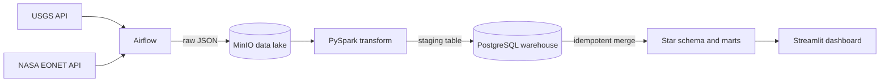

# DisasterLens

DisasterLens collects earthquake data from the USGS API and natural event data from NASA EONET (wildfires, floods, storms, volcanoes and more). It stores the raw responses in MinIO, cleans and deduplicates them with PySpark, loads them into a PostgreSQL warehouse and shows them in a Streamlit dashboard. Airflow runs the pipeline every hour.

## Authors

- Amina Baziz
- Raneem Alhasan

## Architecture



One hourly run of the `disasterlens_pipeline` DAG does this:

1. Download the USGS and EONET responses and save them unchanged in MinIO (`raw/source=.../ingest_date=.../run_id=.../`).
2. Check that both raw files are in the lake.
3. Copy the files of the run to a work folder and clean, deduplicate and map them with PySpark into a staging table.
4. Merge the staging rows into the warehouse. Running the same data twice adds nothing and changes nothing.
5. Refresh the dashboard views, log the run in `ops.pipeline_runs`, and run the data quality rules (results in `ops.dq_results`).

The `disasterlens_backfill` DAG is started by hand and loads historical data (by default the last 12 months of earthquakes and 365 days of EONET events) through the same steps.

## Repository layout

| Path | Purpose |
| --- | --- |
| `dags/` | Airflow DAGs for the hourly pipeline and the historical backfill |
| `src/` | API clients, MinIO storage helpers, PySpark transform and warehouse load |
| `sql/` | Warehouse schema, analytics queries and data quality rules |
| `dashboard/` | Streamlit dashboard and its package list |
| `tests/` | Automated tests (API clients, storage, transform, load, DAGs, data quality) |
| `docs/` | Architecture description, field mapping, runbook and screenshots |
| `Dockerfile` | Airflow image with Java, PySpark, pytest and the PostgreSQL JDBC driver |
| `docker-compose.yml` | Local stack: Airflow, MinIO (community image `pgsty/minio`, console branded SILO) and PostgreSQL |
| `.env.example` | Environment variable names for the stack |
| `requirements.txt` | Python packages used by the project |
| `.gitignore` | Files and folders kept out of version control |

## Prerequisites

- Git
- Docker Desktop, running, with at least 6 GB of memory
- Python 3.10 or newer on your own machine, only for the dashboard

## Quick start

1. Clone the repository and open the folder.
2. Create your own `.env` file by copying `.env.example` to `.env` (PowerShell: `Copy-Item .env.example .env`).
3. Fill in the values in `.env` (see below).
4. Start the stack: `docker compose up -d`. The first start builds the Airflow image and creates the warehouse tables, and takes a few minutes. If the build fails with a download error, run the command again.
5. Check that everything is up: `docker compose ps -a`. `airflow-init` should show `Exited (0)`, which is normal. The other services should be running.
6. Open Airflow (http://localhost:8080), log in, and switch on the `disasterlens_pipeline` DAG with the toggle on the left. It then runs every hour.
7. To load history, trigger `disasterlens_backfill` once with the play button (the default settings are fine). It takes a few minutes. The data lake bucket is created automatically.
8. Install the dashboard packages and start it: `pip install -r dashboard/requirements.txt`, then `streamlit run dashboard/app.py`. It opens at http://localhost:8501.

## Environment variables

No account or API key is needed, these are local settings. Your `.env` file stays on your own machine and is never committed.

- Passwords and usernames: choose your own, using letters and numbers only. The MinIO password needs at least 8 characters.
- `POSTGRES_HOST` and `MINIO_ENDPOINT`: use the service names `postgres` and `minio:9000`.
- `POSTGRES_PORT`: use `5432`.
- `POSTGRES_HOST_PORT`: use `5432`, or another number if that port is already in use on your machine. The dashboard connects to this port.
- `POSTGRES_DB` and `MINIO_BUCKET`: for example `disasterlens` and `disasterlens-lake`.
- `AIRFLOW_UID`: use `50000`.
- `AIRFLOW__CORE__FERNET_KEY`: generate one with `python -c "import base64,os;print(base64.urlsafe_b64encode(os.urandom(32)).decode())"` and paste the result.
- `USGS_API_URL`: `https://earthquake.usgs.gov/earthquakes/feed/v1.0/summary/all_day.geojson`
- `EONET_API_URL`: `https://eonet.gsfc.nasa.gov/api/v3/events`

## Services

| Service | Address | Login |
| --- | --- | --- |
| Airflow | http://localhost:8080 | `AIRFLOW_ADMIN_USER` and `AIRFLOW_ADMIN_PASSWORD` |
| MinIO console | http://localhost:9001 | `MINIO_ROOT_USER` and `MINIO_ROOT_PASSWORD` |
| PostgreSQL | `localhost:<POSTGRES_HOST_PORT>` | `POSTGRES_USER` and `POSTGRES_PASSWORD` |
| Dashboard | http://localhost:8501 | none |

Airflow stores its own tables in the same PostgreSQL database as the warehouse. The warehouse tables use separate schemas (`staging`, `dw`, `mart`, `ops`).

## Dashboard

The dashboard has six tabs: Overview (map, events by hazard type, daily trend), Earthquakes, Other hazards, Events (latest events with search), Data quality (the quality rules checked live) and Pipeline health (recent runs, latest quality results, coverage per source). The sidebar filters the date range, source, hazard type and minimum earthquake magnitude.

## Tests

Run the tests inside the Airflow container (the tests folder is mounted into it):

```
docker compose exec airflow-scheduler python -m pytest tests -q
```

All tests should pass. The load tests use the running PostgreSQL and roll back everything they write.

## Reliability

The pipeline was tested for a repeated run, an API failure, an empty API answer and a full restart. The results and the steps to check and recover the system are in `docs/runbook.md`.

## Versions

| Component | Version |
| --- | --- |
| Apache Airflow | 2.10.5 |
| Python (in Airflow image) | 3.11.11 |
| PySpark | 3.5.3 |
| Java | OpenJDK 17.0.21 |
| PostgreSQL | 16.16 |
| PostgreSQL JDBC driver | 42.7.4 |
| MinIO | pgsty/minio (community image) |

Spark runs inside the Airflow containers in local mode (one node), which is enough for our data volume.

## Troubleshooting

| Problem | What to do |
| --- | --- |
| The dashboard says it could not read from the database | Check `docker compose ps`, start the stack with `docker compose up -d`, and check that `POSTGRES_HOST_PORT` in `.env` is the port you expect |
| Airflow shows `ERR_EMPTY_RESPONSE` right after the start | Wait about a minute and reload, the web server is still starting |
| A DAG does not run | Check that its toggle in Airflow is switched on |
| The image build fails with a download error | Run `docker compose up -d` again |
| Port 5432, 8080, 9000 or 9001 is already in use | Stop the other program, or change `POSTGRES_HOST_PORT` in `.env` |
| You changed `.env` | Run `docker compose up -d --force-recreate airflow-scheduler airflow-webserver` |
| A run failed | Open the red task in Airflow and read its log, then see `docs/runbook.md` |

## Stopping and resetting

- Stop the stack and keep the data: `docker compose down`
- Start it again with the data: `docker compose up -d`
- Delete everything, including the warehouse and the data lake: `docker compose down -v`. Only use this if you want to start from zero.

## Data sources

- USGS earthquake feed and archive: https://earthquake.usgs.gov/fdsnws/event/1/
- NASA EONET: https://eonet.gsfc.nasa.gov/docs/v3

USGS events are instrument observations. EONET events are curated reports built from news and satellite sources. The same real earthquake can appear in both sources, and the two sources are not merged. The historical backfill loads earthquakes of magnitude 2.5 or higher, while the hourly feed also contains smaller ones. The field mapping is in `docs/field_mapping.md`.