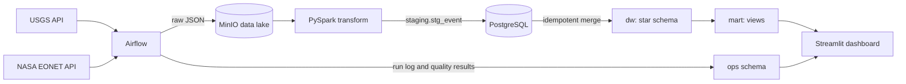

# Architecture

This document describes how DisasterLens is built and why. The step by step view of one run and the setup instructions are in `README.md`, and the failure tests are in `docs/runbook.md`.

## Overview



The pipeline is a batch pipeline. Airflow starts it every hour, and a second DAG loads history by hand. Each layer keeps its own copy of the data, so a problem can be traced back one step at a time.

## Layers

| Layer | Technology | What it holds | Why |
| --- | --- | --- | --- |
| Orchestration | Airflow 2.10 (LocalExecutor) | Two DAGs: `disasterlens_pipeline` (hourly) and `disasterlens_backfill` (manual) | Schedules the tasks, retries failures twice, and shows every run in a UI |
| Data lake | MinIO (S3 compatible) | The raw API responses, unchanged, with a small metadata file per response | Keeps the original data so any run can be repeated or checked |
| Transform | PySpark 3.5 (local mode) | Cleaning, mapping, rejecting bad rows, removing duplicates | Handles both sources with one set of rules and counts every rejected row |
| Warehouse | PostgreSQL 16 | Four schemas: `staging`, `dw`, `mart`, `ops` | One database that holds the tables the dashboard needs and the run log |
| Dashboard | Streamlit | Six tabs over the `mart` and `ops` schemas | Shows the data and the health of the pipeline |

## Data lake layout

```
raw/source=<usgs|eonet>/ingest_date=YYYY-MM-DD/run_id=<run id>/response.json
raw/source=<usgs|eonet>/ingest_date=YYYY-MM-DD/run_id=<run id>/_meta.json
```

The folder names carry the source, the day and the run, so one run can be found, downloaded and processed on its own. `_meta.json` stores the exact URL that was called and when.

## Warehouse

| Schema | Tables and views | Purpose |
| --- | --- | --- |
| `staging` | `stg_event` | Clean rows written by Spark, rebuilt on every run |
| `dw` | `fact_event`, `dim_date`, `dim_source`, `dim_hazard_type` | Star schema. One fact row per source event, holding its latest known version |
| `mart` | `mv_daily_hazard_summary` (materialized view), `v_event_map`, `v_latest_events`, `v_source_coverage` | What the dashboard reads |
| `ops` | `pipeline_runs`, `dq_results` | One row per run, and the result of every data quality rule per run |

The fact table is keyed by `event_key` (the source name and the source's own event id). The dimensions hold the labels once: two sources, 13 hazard types in 6 groups, and a calendar for 2020 to 2030. The field by field mapping from each API to these columns is in `docs/field_mapping.md`.

The materialized view holds the events per day, source and hazard type. It is refreshed after every merge without blocking the dashboard, because the dashboard reads it on every page load.

## Design decisions

- **Raw data first.** Every response is saved in the lake before anything else happens. If the transform or the merge has a bug, the run can be repeated from the lake without calling the APIs again.
- **One common format for two sources.** USGS and EONET have different fields. Spark turns both into the same columns, maps every event to one of our hazard types, and rejects rows that cannot be used (for example a missing id), counting the reason for each.
- **Idempotent merge.** The merge uses `INSERT ... ON CONFLICT (event_key) DO UPDATE`. An event is only changed when the source reports a newer update time, `first_seen_utc` is never overwritten, and `last_seen_utc` always moves forward. Running the same data twice changes nothing, so a retry or a rerun is always safe.
- **Failures are visible.** Each task retries twice, two minutes apart. If the run still fails, the tasks after it are marked `upstream_failed`, `record_run` still runs, and the error is saved in `ops.pipeline_runs`.
- **Data quality as part of the run.** The last task checks the rules in `sql/queries.sql` and stores the results. A failed error rule fails the task, and a failed warning rule only shows on the dashboard.
- **Roles for least privilege.** The schema defines two roles without login: `pipeline_writer` (reads and writes `staging`, `dw`, `ops`) and `dashboard_reader` (reads `mart` and `ops`). They describe the intended separation. In this local setup the services connect with the single database user from `.env`.
- **Local mode on purpose.** Spark runs inside the Airflow container on one node. The data is about 40,000 events per year, which a single node handles in seconds, and it keeps the project easy to start with one command.

## Limits

- The two sources are not merged. The same real earthquake can appear in both.
- The backfill loads earthquakes of magnitude 2.5 or higher, because the USGS archive returns at most 20,000 events per request.
- The counts show how many events were reported, not how severe they were.